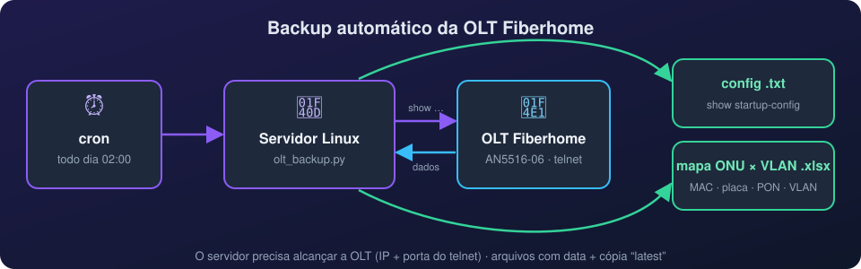
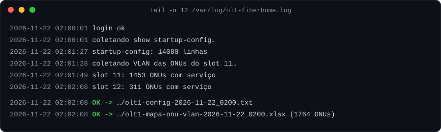
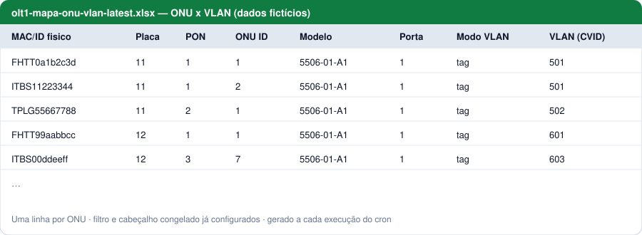

# Backup OLT Fiberhome



Script em Python que faz o backup automático de uma OLT **Fiberhome AN5516-06 (RP1400)** via telnet e gera, a cada execução:

- **`.txt`** com a configuração completa (`show startup-config`), em bloco de notas.
- **`.xlsx`** com o mapa de todas as ONUs: MAC/ID físico, placa, PON, ONU ID, modelo, porta, modo e **VLAN**.

Pensado para rodar no `cron` de um Linux e deixar os arquivos numa pasta que você consulta por um painel/servidor de arquivos.

> A VLAN de cada ONU **não vem** no `show startup-config` da OLT. Por isso o script a lê à parte (`show onufe_service`) e cruza com o MAC de cada ONU.

## Como usar

1. Copie o repositório para o servidor Linux, por exemplo em `/opt/olt-fiberhome/`.
2. Instale a dependência: `sudo apt install python3-openpyxl` (ou `pip install openpyxl`).
3. Crie a configuração da OLT a partir do modelo e proteja o arquivo:
   ```bash
   cp olt.conf.example olt1.conf
   nano olt1.conf          # IP, porta, usuário, senhas, slots e pasta de saída
   chmod 600 olt1.conf
   ```
4. Teste uma vez na mão (leva 1 a 3 minutos):
   ```bash
   python3 olt_backup.py olt1.conf
   ```
5. Agende no cron (todo dia às 02:00). Copie e cole no terminal, ajustando `USUARIO` (quem será o dono dos arquivos gerados) e os caminhos se precisar:
   ```bash
   sudo touch /var/log/olt-fiberhome.log
   sudo chown USUARIO /var/log/olt-fiberhome.log
   echo '0 2 * * * USUARIO /usr/bin/python3 /opt/olt-fiberhome/olt_backup.py /opt/olt-fiberhome/olt1.conf >> /var/log/olt-fiberhome.log 2>&1' | sudo tee /etc/cron.d/olt-fiberhome
   sudo chmod 644 /etc/cron.d/olt-fiberhome
   ```
   Formato do horário: `minuto hora dia mês dia-da-semana`. Para outro horário, troque o `0 2` (ex.: `30 3` = 03:30).
   Alternativa sem `/etc/cron.d`: `crontab -e` e cole a linha **sem** o campo `USUARIO`.

## Onde ver os logs

```bash
tail -n 30 /var/log/olt-fiberhome.log      # últimas execuções
tail -f /var/log/olt-fiberhome.log         # acompanhar ao vivo
grep ERRO /var/log/olt-fiberhome.log       # só as falhas
```

Exemplo de uma execução bem-sucedida:



Uma execução boa termina com duas linhas `OK -> ...` (config e mapa). Em falha o script tenta 3 vezes (2 min entre elas) e registra `ERRO (tentativa n/3)`. O agendamento em si aparece em `grep CRON /var/log/syslog` (ou `journalctl -u cron`).

## Arquivos gerados

Exemplo do mapa ONU × VLAN (dados fictícios):



| Arquivo | Conteúdo |
|---|---|
| `olt1-config-AAAA-MM-DD_HHMM.txt` | Configuração completa, com data (histórico) |
| `olt1-mapa-onu-vlan-AAAA-MM-DD_HHMM.xlsx` | Mapa ONU × VLAN, com data (histórico) |
| `olt1-config-latest.txt` / `olt1-mapa-onu-vlan-latest.xlsx` | Cópia da última execução, com nome fixo |

Arquivos datados com mais de `retention_days` dias são apagados. Se a coleta falhar ou vier incompleta, **nada é sobrescrito**.

## Várias OLTs

Um `.conf` por OLT, com `name` diferente, e uma linha de cron para cada um:

```bash
cp olt1.conf olt2.conf    # troque host, senhas e name = olt2
```

## Novas ONUs

Não precisa mexer em nada: todas as ONUs dos `slots` configurados entram sozinhas no próximo backup. Só altere `slots` se surgir uma placa PON nova.

## Requisitos

- Linux com `cron` e Python 3.8+ (testado em Debian 13 / Python 3.13)
- `python3-openpyxl` (sem ele o script gera CSV no lugar do XLSX)
- **O servidor que roda o script precisa alcançar a OLT na rede** (IP e porta do telnet, direto, por VPN ou por redirecionamento de porta). Teste antes: `telnet IP_DA_OLT PORTA` (ou `nc -vz IP_DA_OLT PORTA`) a partir do próprio servidor
- Usuário na OLT com permissão de leitura
- Opcional: `paramiko` (`pip install paramiko`) para enviar os arquivos a um servidor SFTP

## Segurança

- **Não use os usuários e senhas padrão da OLT** (os de fábrica são públicos e conhecidos). Crie na OLT um usuário próprio, com senha forte, só para o backup (de preferência com permissão apenas de leitura), troque as senhas padrão e use esse usuário no `olt1.conf`.
- O `olt1.conf` guarda senhas em texto: `chmod 600` e **nunca** versione (o `.gitignore` já bloqueia `*.conf`, `*.txt`, `*.xlsx` e `*.csv`).
- Os arquivos gerados contêm a configuração da OLT, hashes de usuários e o MAC dos clientes. Restrinja o acesso à pasta.
- Telnet trafega em texto puro: use em rede interna ou VPN.

## Aviso

O script só executa comandos de **leitura** (`show ...` e `cd`) e não altera nada na OLT. Mesmo assim, em OLTs com muitas ONUs a coleta é pesada para a CPU: evite rodar em horário de pico. Use por sua conta e risco.

## Licença

[MIT](LICENSE)
